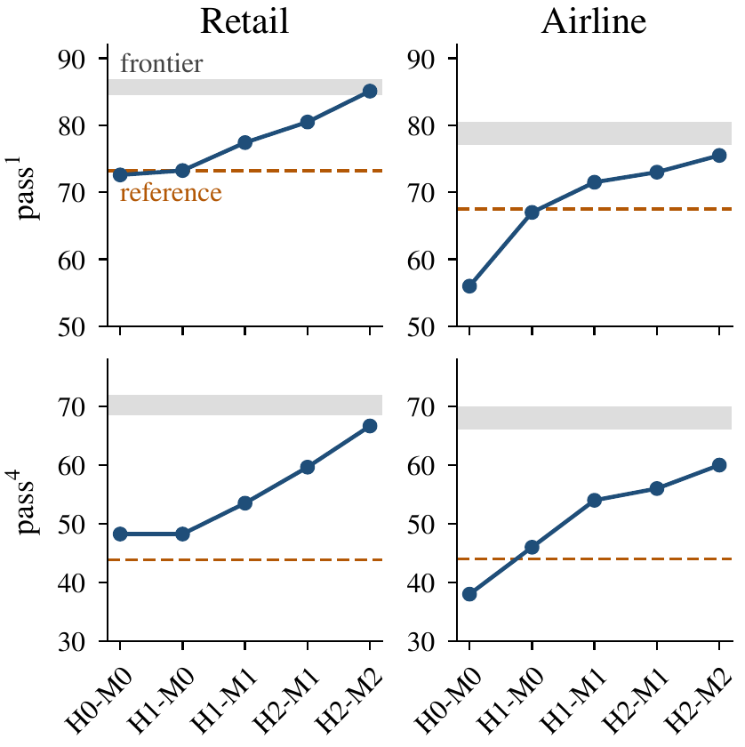

# Knowledge in the Harness, Reliability in the Weights

Code, data, and run records for the paper

> **Knowledge in the Harness, Reliability in the Weights: Teacher-Free Co-Evolution of an LLM Agent**<br>
> Yujia Zhang, Xinqi Ren, Shixiong Zhou, Jia Meng (Brightendata)<br>
> arXiv: *link to be added*

A Gemma 4 12B customer-service agent improves itself on [τ²-bench](https://github.com/sierra-research/tau2-bench) from its own deployment logs, in two layers, without a stronger model to write its rules or supply its training signal:

- **Harness.** The domain policy is delivered as on-demand skills: an entry document with the general clauses and a routing table, and one skill per kind of database write. Each round, the base model diagnoses the agent's failed conversations and writes short rules into the skills. Code checks, counterexample self-review, paired retests, and validation gates decide which rules survive.
- **Weights.** GRPO trains a LoRA adapter on whole multi-turn, tool-using conversations, including the skill loads, on four GPUs.

The official τ²-bench tasks are never used for rule editing, training, or version selection; validation and training tasks come from an LLM-free generator included here.

<p align="center"></p>

## Results

Official τ²-bench tasks (retail 114, airline 50), 4 trials per task, DeepSeek-V4.1-Flash as the user simulator for every system.

| System | Retail pass^1 | Retail pass^4 | Airline pass^1 | Airline pass^4 |
|---|---:|---:|---:|---:|
| Gemma 4 12B, τ²-bench reference agent (policy in the system prompt) | 73.2 | 43.9 | 67.5 | 44.0 |
| Gemma 4 12B, skill harness before evolution (H0-M0) | 72.6 | 48.2 | 56.0 | 38.0 |
| H1-M0 (round 1, harness) | 73.2 | 48.2 | 67.0 | 46.0 |
| H1-M1 (round 1, weights) | 77.4 | 53.5 | 71.5 | 54.0 |
| H2-M1 (round 2, harness) | 80.5 | 59.6 | 73.0 | 56.0 |
| **H2-M2 (round 2, weights)** | **85.1** | **66.7** | **75.5** | **60.0** |
| H2-M0 (evolved harness, base weights) | 77.4 | 48.2 | 68.5 | 48.0 |
| H0-M2 (trained weights, original harness) | 78.3 | 54.4 | 62.5 | 52.0 |
| GPT-5.6-sol, skill harness (H0) | 86.0 | 71.1 | 77.0 | 70.0 |
| Claude Sonnet 5, skill harness (H0) | 84.4 | 68.4 | 80.5 | 66.0 |
| GLM-5.2, skill harness (H0) | 86.8 | 71.9 | 77.0 | 66.0 |

H*i*-M*j* is the system after *i* accepted harness updates and *j* accepted weight updates. `python paper/tables.py` recomputes these numbers, their confidence intervals, and the paper's other tables and statistics from the records in this repository.

What the two layers learn (Section 5 of the paper):

- **Rules rescue, weights stabilize.** On official tasks the base system never solved, the evolved rules alone reach 27–44% success and the trained weights alone 5–25%; on tasks it always solved, the trained weights alone hold 95–99% and the rules alone 87–93%.
- **Knowledge stays in the harness.** GRPO under the evolved rules does not move the airline baggage-allowance formula into the weights: without the rules, the trained model still fails every baggage conversation that skips the booking skill.
- **The validation set is a faithful proxy.** Across the eight accepted updates, pass^1 gains on the generated validation set and on the official tasks correlate at r = 0.98.

## Terms in the code and in the paper

| Code | Paper |
|---|---|
| plugin, plugin evolution, plugin gate | harness (the skills and their rules), harness evolution, harness gate |
| `official_setting` | the τ²-bench reference agent (policy in the system prompt) |
| difficulty profile (`profile/`, `rsi.pipeline.profile`) | profiling pass |
| the round's six steps: collection (1), plugin evolution (2) and its gate (3), difficulty profile (4), GRPO (5), model gate (6) | the round's four stages, with each gate counted under the layer it decides |
| `regression` (the control tasks of a step in `events.jsonl`) | always-solved control tasks |
| plugin versions `v00`, `v01`, … in `plugins/versions.json` | harness candidates within one evolution attempt |
| `_retry` | the second evolution attempt after a rejected harness candidate |

## Repository layout

```
plugins/              H0: each domain's policy split verbatim into an entry document and one skill per write type
src/rsi/
  agent/              the plugin agent (load_skill) on top of tau2's LLM agent; h0.py builds plugins/ from the policies
  harness_rsi/        harness evolution: evidence packs, editor prompts and checks, retests, attributed reverts
  grpo/               multi-turn GRPO update with exact prefix-tree packing and per-sequence gradient filtering
  pipeline/           one round: collection, harness evolution and its gate, profiling pass, GRPO, model gate
  benchmarks/         running tau2, evaluation on the official tasks, the reference agent, API models as the agent
  data_preprocessing/ generators of the validation set and the training batches
config/               every human-set parameter of a round (identical in both rounds and both domains)
data/                 generated tasks, splits, knowledge-point annotation of the official tasks
results/              official-task trajectories of every system in the paper (tau2 format, gzip)
artifacts/logs/r1,r2/ records of the two rounds (see "Run records")
paper/                scripts that recompute the paper's numbers and figures from results/ and artifacts/logs/
scripts/              model server, pinned environments, smoke test
tests/                unit tests and generator checks
```

## Setup

1. **Python environment** (Python 3.12). τ²-bench is cloned into the repository root at the pinned commit, since the generated tasks run on its database files:
   ```bash
   git clone https://github.com/Brightendata/knowledge-in-the-harness && cd knowledge-in-the-harness
   git clone https://github.com/sierra-research/tau2-bench
   git -C tau2-bench checkout 4ce7c0397c1eb65c9bbe59aeacfe1ca44a1cd699
   pip install -r scripts/env/rsi-env.txt
   pip install --no-deps -e ./tau2-bench -e .
   ```
   `scripts/env/rsi-env.txt` pins the exact package versions of the paper's runs.
2. **Model server** (only for running agents). Install vLLM from `scripts/env/vllm-env.txt` in a separate environment, download the weights, and start the server, one replica per GPU:
   ```bash
   hf download google/gemma-4-12B-it --revision 707f0a3b8a3c7ad586ed01e27eafbad8a27dd0f7 --local-dir models/gemma-4-12B-it
   GPUS=0,1 scripts/serve_gemma.sh
   ```
   `scripts/env/gemma-4-12B-it.sha256` lists the checksums of the weight files.
3. **API keys** (only for running conversations). Create `.env` with `DEEPSEEK_API_KEY` (the user simulator) and `OPENAI_API_KEY` (gpt-4.1, which judges the natural-language assertions of retail's official tasks).

## Reproducing the paper

**Numbers and figures, from the released records.** No GPU, model, or API key is needed; the figures also need `matplotlib` (3.11.2 reproduces the released PDFs byte for byte):
```bash
python paper/tables.py      # the paper's tables and statistics, with paired bootstrap intervals
python paper/figures.py     # writes paper/figures/*.pdf
python paper/isolation.py   # overlap between generated and official tasks (needs the tau2-bench clone)
```
The rule table and the worked example in Appendix B quote the editor's records under `artifacts/logs/r*/harness_rsi/` directly.

**Evaluate a version on the official tasks.** The harness of each version is read from the gate decisions in `artifacts/logs/`. The trained adapters, M1 and M2 of each domain, are attached to release [v1.0](../../releases/tag/v1.0) of this repository: unzip the four archives at the repository root, where they unpack into `artifacts/checkpoints/` as the gate decisions expect.
```bash
python -m rsi.benchmarks.evaluate H2-M2 --retail
python -m rsi.benchmarks.evaluate H2-M2 --airline
python -m rsi.benchmarks.baseline --retail          # the reference agent
```
The cross versions of the ablation run the same way (`python -m rsi.benchmarks.evaluate H2-M0 --retail`, and likewise for H0-M2 and the airline domain), and the API models with `rsi.benchmarks.evaluate_api`, whose docstring gives its usage.

**Run a round of evolution.** Collection, harness evolution with its gate, the profiling pass, GRPO, and the model gate run in sequence, and a rerun resumes where it stopped. The pipeline skips work whose records exist, so move the released records aside first:
```bash
mv artifacts/logs artifacts/logs_paper
python -m rsi.pipeline.run_pipeline --round 1
```
GPU assignments and the recipe are in `config/`. The pipeline starts the model server and the trainer itself, so run it with the vLLM environment's `bin` on `PATH` and set `[grpo] python` in `config/grpo_config.toml` to that environment's interpreter. The paper's runs used four 80 GB GPUs: a round over both domains takes about 84 hours and 50k conversations.

**Regenerate the tasks.** The generators are deterministic; run in this order, they reproduce `data/` byte for byte:
```bash
python -m rsi.data_preprocessing.retail_generator
python -m rsi.data_preprocessing.airline_generator
python -m rsi.data_preprocessing.manual_fixes    # wording fixes from the review, applied to both domains' final tasks
```

**Tests.** The unit tests need no model server. The GRPO tests (`tests/test_grpo.py`, including the check that packed and separate log-probabilities agree) also need the training packages pinned in `scripts/env/vllm-env.txt`. The generator checks grade every 20th task by default; `SHARD=0/1` grades all of them, and `SHARD=k/n` splits the work over `n` processes.
```bash
pip install torch==2.13.0 transformers==5.19.0 peft==0.21.2 safetensors==0.8.0
python -m unittest discover -s tests
```

**Smoke test** (needs the model server and a DeepSeek key; about 50 short conversations):
```bash
python scripts/smoke_harness.py
```

## Generated tasks

`data/processed/<domain>_final.jsonl` holds the 1,100 tasks per domain used in the paper, one JSON object per line: the τ²-bench task (`task`: user scenario and evaluation criteria with the reference actions), the path of its database in the τ²-bench clone (`db`), its knowledge-point tags (`tags`), its customer (`customer`), and the scenario its variants share (`group`), which the splits keep together. `data/splits/<domain>.json` assigns them to the validation set (`validation`, 200) and the three training batches (`round1` to `round3`, 300 each); the paper's two rounds used the first two. `<domain>_generated.jsonl` holds all candidates the selection drew from, and `data/reports/` the generators' coverage reports. `data/test_annotation.json` lists the knowledge points of each official task, read from the public task definitions; the selection of V and the training batches matches their shares, and the paper's analyses group the official results by them.

## Run records

The pipeline writes every conversation of a round (several GB); the repository keeps compact records of the paper's two rounds. An `outcomes.json` holds the rewards per task and trial of the result files a run writes (`collect/<domain>.json`, or an arm's `current.json` and `candidate.json`), `evidence.jsonl.gz` is a step's `evidence.jsonl` compressed, and `packs.jsonl` collects the per-pack statistics the trainer logs. Each round's records in `artifacts/logs/r<k>/`:

| Path | Contents |
|---|---|
| `collect/<domain>.outcomes.json` | the deployed system on the round's batch: rewards per task and trial |
| `harness_rsi/<domain>[_retry]/` | one harness-evolution attempt: `config.json`, `events.jsonl` (steps, merges, retests, reverts), `plugins/versions.json` (the version tree), and per step the evidence pack of each analyzed failure (`evidence.jsonl.gz`), the editor's diagnoses (`analysis.jsonl`), its merge with the checks' verdicts (`merge.json`), and the retest rewards (`outcomes.json`) |
| `gate/plugin_<domain>[_retry]/` | a harness gate on V: `decision.json` (scores, intervals, verdict) and `outcomes.json` (rewards and a hash of the simulator's first utterance, the first 12 hex digits of its SHA-1, per task and trial, for both arms) |
| `profile/<domain>.outcomes.json` | the profiling pass under the accepted harness, which sets GRPO's first-epoch rollout counts |
| `grpo/<domain>/` | GRPO: `config.json`, `events.jsonl` (per step, the successes of every task's rollouts), `summary.log` (per step, loss, gradient norm, filtered packs, clipping), `packs.jsonl` (per packed sequence, its tokens, gradient norm, gradient per token, and whether it was left out) |
| `gate/model_<domain>/` | the model gate: `decision.json` and the checkpoints' `outcomes.json` |
| `plugins/<domain>_final*_accepted/` | the harness accepted in this round |

`results/<system>/<domain>.json.gz` are τ²-bench result files with the full conversations, including the agent's reasoning and skill loads; of the raw model responses, only the choices and token usage are kept. `rsi.benchmarks.evaluate` writes uncompressed `.json` files of the same format, which `rsi.benchmarks.score` reads.

## Citation

```bibtex
@misc{zhang2026knowledge,
  title  = {Knowledge in the Harness, Reliability in the Weights: Teacher-Free Co-Evolution of an LLM Agent},
  author = {Zhang, Yujia and Ren, Xinqi and Zhou, Shixiong and Meng, Jia},
  year   = {2026},
  note   = {arXiv preprint}
}
```

## License

This repository, including the generated tasks, the evolved plugins, and the run records, is released under the [Apache License 2.0](LICENSE). Copyright 2026 Brightendata.

The generated tasks build on the domains and databases of [τ²-bench](https://github.com/sierra-research/tau2-bench), and `plugins/` quotes its policies (MIT License, Copyright (c) 2025 Sierra Research; reproduced in `LICENSES/tau2-bench-MIT.txt`). The adapters are fine-tuned from [Gemma 4](https://huggingface.co/google/gemma-4-12B-it), which is distributed under its own license.
